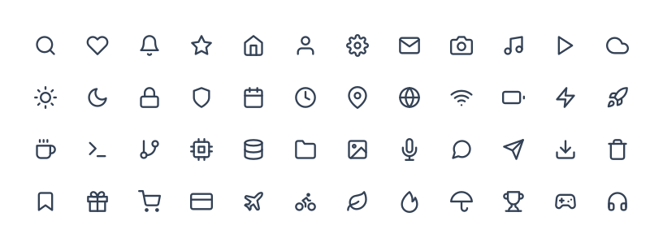

<p align="center">
  
</p>

<h1 align="center">Beluga Icon</h1>

<p align="center">
  1800+ stroke-based SVG icons for React — with built-in animations, visual styles, and full TypeScript support.
</p>

<p align="center">
  <a href="https://fatihserhatturan.github.io/Beluga-Icon/"><b>Live demo</b></a> ·
  <a href="https://www.npmjs.com/package/@beluga-icon/react"><b>npm</b></a> ·
  <a href="#quick-start"><b>Quick start</b></a> ·
  <a href="#props"><b>API</b></a> ·
  <a href="#contributing"><b>Contributing</b></a>
</p>

<p align="center">
  <a href="https://github.com/fatihserhatturan/Beluga-Icon/actions/workflows/ci.yml">
    
  </a>
  <a href="https://fatihserhatturan.github.io/Beluga-Icon/">
    
  </a>
  <a href="https://www.npmjs.com/package/@beluga-icon/react">
    
  </a>
  <a href="https://www.npmjs.com/package/@beluga-icon/react">
    
  </a>
  
  
</p>

<p align="center">
  <a href="https://fatihserhatturan.github.io/Beluga-Icon/">
    
  </a>
</p>

<p align="center">
  <b>Bring your own style.</b> Every icon accepts an <code>iconStyle</code> and <code>animation</code> prop — no extra wrappers, no CSS overrides needed.
</p>

---

## Features

- **1800+ icons** across 30 categories, drawn on a consistent 24×24 stroke grid
- **21 visual styles** — glass, neon, liquid, neumorphic, metallic and more — via a single `iconStyle` prop
- **46 animations** with four triggers: on mount, hover, click, or when scrolled into view
- **Tree-shakeable** — named exports, `"sideEffects": false`, and per-icon import paths
- **TypeScript strict** — typed props, style and animation names
- **Accessible by default** — decorative unless you give an icon a `label`
- **Global defaults** with `IconProvider`, and your own icons with `createIcon`

## Contents

- [Installation](#installation)
- [Quick Start](#quick-start)
- [Props](#props)
- [Styles](#styles)
- [Animations](#animations)
- [IconProvider — Global Defaults](#iconprovider--global-defaults)
- [Custom Icons](#custom-icons)
- [Accessibility](#accessibility)
- [Tree Shaking](#tree-shaking)
- [Icon Categories](#icon-categories)
- [Packages](#packages)
- [Contributing](#contributing)
- [License](#license)

---

## Installation

```bash
npm install @beluga-icon/react
```

**Peer dependency:** React ≥ 17

## Quick Start

```tsx
import { SearchIcon, HeartIcon, BellIcon } from '@beluga-icon/react'

function App() {
  return (
    <div>
      {/* Default — inherits color from CSS */}
      <SearchIcon />

      {/* Glass style with hover animation */}
      <HeartIcon iconStyle="glass" animation="heartbeat" trigger="hover" />

      {/* Neon glow with custom color */}
      <BellIcon iconStyle="neon" color="#a855f7" animation="pulse" />

      {/* Accessible — screen reader visible */}
      <SearchIcon size="lg" label="Search" />
    </div>
  )
}
```

Browse every icon, style and animation in the [live demo](https://fatihserhatturan.github.io/Beluga-Icon/).

## Props

| Prop          | Type                                                      | Default          | Description                                    |
| ------------- | --------------------------------------------------------- | ---------------- | ---------------------------------------------- |
| `size`        | `'xs' \| 'sm' \| 'md' \| 'lg' \| 'xl' \| '2xl' \| number` | `'md'`           | Named size or pixel value                      |
| `color`       | `string`                                                  | `'currentColor'` | Stroke color — any valid CSS color             |
| `strokeWidth` | `number`                                                  | `2`              | Stroke width in pixels                         |
| `iconStyle`   | `IconStyleType`                                           | —                | Visual style preset                            |
| `styleColors` | `Record<string, string>`                                  | —                | Custom color injection for color-aware styles  |
| `animation`   | `AnimKey`                                                 | —                | Animation preset                               |
| `trigger`     | `'auto' \| 'hover' \| 'click' \| 'visible'`               | `'auto'`         | When the animation plays                       |
| `speed`       | `'slow' \| 'normal' \| 'fast'`                            | `'normal'`       | Animation speed                                |
| `playOnce`    | `boolean`                                                 | `false`          | Play once instead of looping                   |
| `label`       | `string`                                                  | —                | Accessible label (`aria-label` + `role="img"`) |
| `className`   | `string`                                                  | —                | Extra class on the `<svg>` element             |
| `ref`         | `React.Ref<SVGSVGElement>`                                | —                | Forwarded ref to the underlying SVG            |

All standard SVG attributes (`onClick`, `style`, `data-*`, etc.) are also accepted.

## Styles

21 built-in visual style presets — apply any one with the `iconStyle` prop.

| Style          | Description                                      |
| -------------- | ------------------------------------------------ |
| `circle`       | Solid filled circle background                   |
| `rounded`      | Rounded square background                        |
| `flat`         | Minimal flat background                          |
| `outline`      | Thin border, transparent fill                    |
| `ghost`        | Subtle transparent fill, no border               |
| `glass`        | Frosted glass with backdrop blur                 |
| `liquid`       | Apple Liquid Glass — layered specular highlights |
| `neon`         | Glowing neon drop-shadow                         |
| `glow`         | Soft pulsing glow ring                           |
| `shadow`       | Elevated with layered box shadow                 |
| `gradient`     | Diagonal gradient background                     |
| `badge`        | Compact badge shape                              |
| `outline-ring` | Double border ring                               |
| `neumorphic`   | Soft-UI extruded surface                         |
| `emboss`       | Pressed emboss effect                            |
| `inset`        | Inset / debossed surface                         |
| `ios`          | iOS-style rounded square                         |
| `fluent`       | Microsoft Fluent-inspired surface                |
| `metallic`     | Brushed metal sheen                              |
| `duotone`      | Two-tone layered fill                            |
| `aurora`       | Animated hue-shifting gradient                   |

### Color Injection

Color-aware styles accept custom palettes via `styleColors`:

```tsx
// Gradient
<StarIcon iconStyle="gradient" styleColors={{ from: '#f43f5e', mid: '#a855f7', to: '#06b6d4' }} />

// Aurora — three hue stops
<BellIcon iconStyle="aurora" styleColors={{ a: '#06b6d4', b: '#8b5cf6', c: '#f43f5e' }} />

// Metallic
<LockIcon iconStyle="metallic" styleColors={{ light: '#e2e8f0', base: '#94a3b8', dark: '#475569' }} />

// Duotone
<HeartIcon iconStyle="duotone" styleColors={{ a: '#f43f5e', b: '#fecdd3' }} />
```

## Animations

46 built-in animation presets — apply any one with the `animation` prop.

| Group          | Presets                                                                                                                                                   |
| -------------- | --------------------------------------------------------------------------------------------------------------------------------------------------------- |
| **Mechanical** | `spin` `pulse` `bounce` `shake` `wiggle` `ping` `blink` `float` `heartbeat` `flash` `tada` `jello` `swing` `rubberBand` `flipX` `breathe` `wobble` `roll` |
| **SVG Path**   | `draw` `erase` `trace`                                                                                                                                    |
| **Effects**    | `neon` `glitch` `flicker` `hologram` `electric` `ghost` `burst` `heat` `crystal` `rgbSplit` `liquidMorph` `aurora` `shatter` `cinematic`                  |
| **Physics**    | `zoomIn` `fadeUp` `levitate` `springPop` `decay` `magnetPulse` `wobbleSpring`                                                                             |

### Trigger Modes

```tsx
// Plays on mount, loops
<LoaderIcon animation="spin" trigger="auto" />

// Plays once on hover
<BellIcon animation="shake" trigger="hover" playOnce />

// Plays on click
<HeartIcon animation="heartbeat" trigger="click" />

// Plays when scrolled into view
<StarIcon animation="draw" trigger="visible" playOnce />
```

## IconProvider — Global Defaults

Set default props for all icons in a subtree. Explicit props on individual icons always win.

```tsx
import { IconProvider } from '@beluga-icon/react'

<IconProvider iconStyle="glass" animation="pulse" trigger="hover" size="lg">
  <SearchIcon />                {/* inherits all provider defaults */}
  <HeartIcon color="#ef4444" /> {/* overrides color, inherits the rest */}
</IconProvider>
```

## Custom Icons

Create your own icons with the same API — animations, styles, and provider support included.

```tsx
import { createIcon } from '@beluga-icon/react'

const MyBrandIcon = createIcon({
  displayName: 'MyBrandIcon',
  render: () => (
    <>
      <circle cx="12" cy="12" r="10" />
      <path d="M8 12h8M12 8v8" />
    </>
  ),
})

<MyBrandIcon size="xl" iconStyle="glass" animation="pulse" label="My Brand" />
```

## Accessibility

Icons are **decorative by default** (`aria-hidden="true"`). Add a `label` to expose them to screen readers:

```tsx
// Decorative — hidden from screen readers
<HeartIcon />

// Accessible — announces "Add to favorites"
<HeartIcon label="Add to favorites" />
```

## Tree Shaking

All exports are named and `"sideEffects": false` is set in `package.json`. Only the icons you import are included in your bundle.

```tsx
import { SearchIcon, HeartIcon, BellIcon } from '@beluga-icon/react'
```

For the smallest possible import path, you can also import a single icon module:

```tsx
import { SearchIcon } from '@beluga-icon/react/icons/ui/Search'
```

## Icon Categories

1800+ icons in 30 categories. Search them all in the [live demo](https://fatihserhatturan.github.io/Beluga-Icon/).

| Category      | Icons | Category     | Icons | Category       | Icons |
| ------------- | ----: | ------------ | ----: | -------------- | ----: |
| accessibility |     8 | gaming       |    37 | security       |    23 |
| arrows        |   158 | layout       |    10 | shapes         |   152 |
| buildings     |    64 | math         |    10 | social         |   148 |
| chart         |    54 | media        |    73 | sports         |     3 |
| commerce      |    47 | medical      |    35 | status         |    37 |
| communication |    59 | nature       |    61 | text           |   114 |
| development   |    91 | navigation   |    23 | time           |    51 |
| devices       |    88 | network      |    27 | transportation |    38 |
| files         |   119 | productivity |    12 | ui             |   195 |
| food          |    60 | users        |    24 | weather        |    20 |

## Packages

| Package                                  | Version                                                                                                                  | Description              |
| ---------------------------------------- | ------------------------------------------------------------------------------------------------------------------------ | ------------------------ |
| [`@beluga-icon/react`](./packages/react) | [](https://www.npmjs.com/package/@beluga-icon/react) | React icon components    |
| [`@beluga-icon/core`](./packages/core)   | [](https://www.npmjs.com/package/@beluga-icon/core)   | Shared types & utilities |

## Contributing

Issues and pull requests are welcome. To work on the library locally (Node ≥ 20.19):

```bash
git clone https://github.com/fatihserhatturan/Beluga-Icon.git
cd Beluga-Icon
npm ci
npm run demo       # start the demo app
npm test           # run the test suite
```

Icons live as plain SVG files in [`svgs/<category>/`](./svgs) — 24×24 viewBox, stroke-based, kebab-case names. After adding or changing one:

```bash
npm run generate        # regenerate the React components
npm run readme:preview  # refresh docs/preview.svg (optional)
npm run changeset       # describe the change for the next release
```

Before opening a PR, make sure `npm run lint`, `npm run typecheck`, `npm test` and `npm run build` pass — CI runs the same checks.

## License

MIT. Some icon artwork is derived from or inspired by Lucide Icons and remains
subject to the notices in [THIRD_PARTY_NOTICES.md](./THIRD_PARTY_NOTICES.md).
